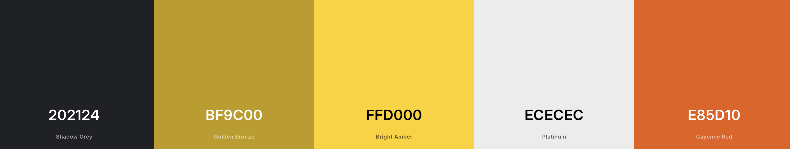

# Hulen Admin

`under construction`

A frontend for viewing and managing human resources at Hulen. We're building an application that shows a table with information retrieved from a database of volunteers, allowing managers to view and edit each entry. At the moment, though, the sample data is hard-coded in a JSON file. We'll connect this frontend to the real database once it becomes available.

## Frontend

- React
- TypeScript
- TailwindCSS

## Design elements

### Colour palette

Based on the same yellow used in Hulen.no, I've created this WCAG AA-compliant colour palette. It should cover the project's basic needs. The reddish shade is just for error messages. Use it sparingly.



### Typography

The chosen font pairing for now is Bebas Neue (headers) and Abel (body). I've installed them via `pnpm` packages, from the [Fontsource](https://fontsource.org) archive.

### Icons

The [Lucide](https://lucide.dev) icon library is currently being used in this project.

## Running it locally

Assuming you have NodeJS installed, just clone the repo and install its dependencies:

```shell
git clone <repo-url>
cd hulen-admin
pnpm install
pnpm dev
```
